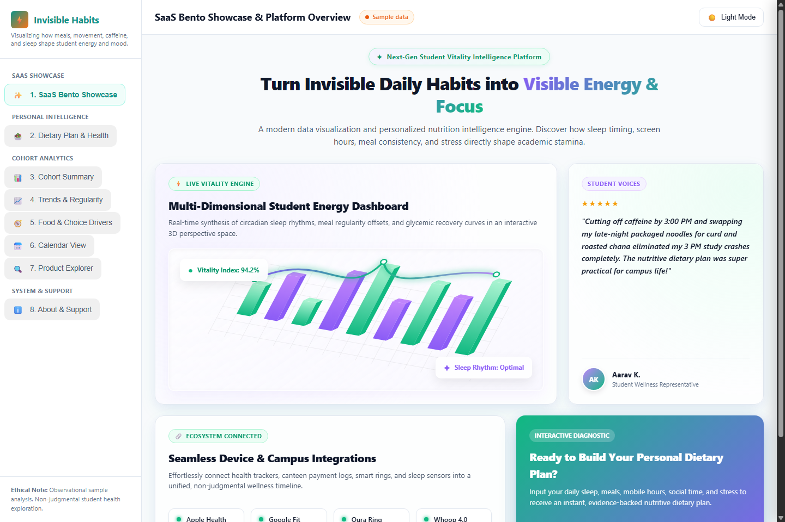
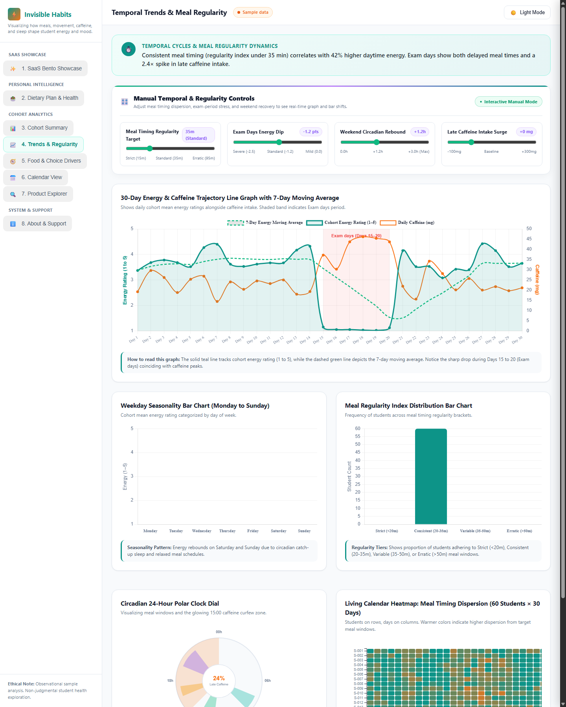
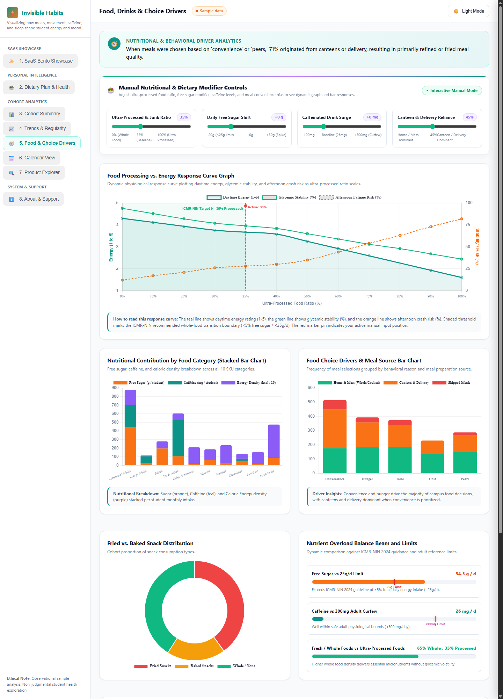
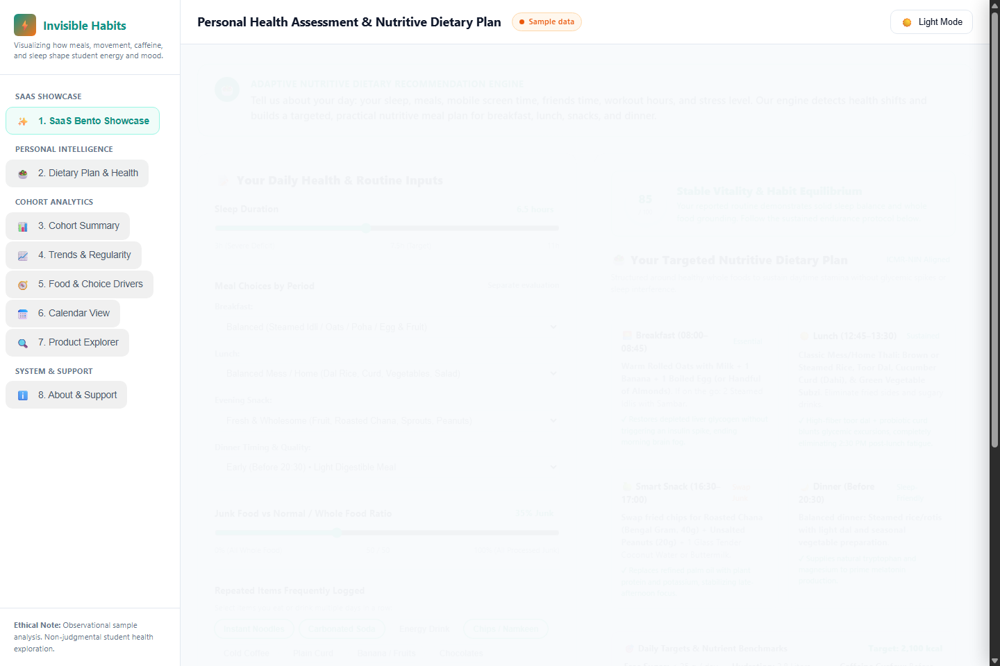

# Invisible Habits, Visible Energy

> **Visualizing how meals, movement, caffeine, and sleep shape student energy and mood.**

[](https://developer.mozilla.org/en-US/docs/Web/HTML)
[](https://developer.mozilla.org/en-US/docs/Web/CSS)
[](https://developer.mozilla.org/en-US/docs/Web/JavaScript)
[](https://www.chartjs.org/)
[](https://d3js.org/)
[](LICENSE)
[](#architecture--tech-stack)

A modern, highly polished single-page data visualization dashboard designed to reveal the hidden physiological connections between everyday micro-habits—meal timing regularities, ultra-processed food consumption, caffeine intake past 15:00, sleep compression, and physical movement—and daytime energy/mood vitality.

Built with **vanilla HTML5, modern CSS3 (Glassmorphism + Bento Box Grid), and ES6+ JavaScript**, with **Chart.js v4.4** and **D3.js v7** loaded via CDN. Runs 100% locally in the browser with **zero backend dependencies**, zero build step, and immediate **GitHub Pages** compatibility.

---

## 🌟 Visual Showcase

### 1. SaaS Bento Box Showcase & Platform Hub
Modular bento grid structure with subtle glassmorphism accents, 3D product dashboard chart graphic, live cohort stat pills, and quick tab navigation.


---

### 2. Temporal Trends & Circadian Regularity (Tab 4)
30-Day dual-axis trajectory line chart with 7-day centered moving average spline, shaded **Exam days** context window, circadian polar clock dial, and living calendar regularity heatmap.


---

### 3. Food Processing & Choice Drivers (Tab 5)
Interactive Food Processing vs. Energy Response Curve with dynamic simulation pin, category nutrient stacked bar chart, food choice drivers grouped bar chart, and living D3 Sankey flow diagram.


---

### 4. Nutritive Dietary Recommendation Engine (Tab 2)
Customized lifestyle intake questionnaire (sleep hours, discrete meals, screen time, peer time, junk ratio, workout, stress) translating into dynamic vitality shift scores and ICMR-NIN compliant campus whole-food meal plans.


---

## 🚀 Quick Start (Running Locally)

This project requires **no database, no Node.js build process, and no package installation**. You can run it immediately using any of the methods below:

### Option A: Local Python Server (Recommended)
```bash
# Clone the repository
git clone https://github.com/kajanbirla/ADVT.git
cd ADVT

# Start local server on port 5555
python -m http.server 5555
```
Open **`http://localhost:5555`** in your browser.

### Option B: Node.js (npx serve)
```bash
npx serve . -p 5555
# or
npm start
```

### Option C: Direct File Launch
Simply double-click **`index.html`** or drag-and-drop it into Chrome, Edge, Safari, or Firefox.

---

## 🌐 Deploy to GitHub Pages in 30 Seconds

1. Push this repository to GitHub.
2. In your repository on GitHub, go to **Settings** &rarr; **Pages**.
3. Under **Branch**, select **`main`** and folder **`/ (root)`**.
4. Click **Save**.
5. Your live dashboard will be published at `https://<your-username>.github.io/<repo-name>/`!

---

## 📊 Dashboard Modules & Architecture

The application is structured into **13 interactive views** accessible via the sidebar and top navigation:

| View / Tab | Visualization Technique | Core Insight & Interaction |
| :--- | :--- | :--- |
| **0. Showcase Bento UI** | 3D Perspective Graphic & Bento Grid | Executive summary, key metric pills, testimonials, and system architecture. |
| **1. Summary (My Summary)** | 4 Metric KPI Sparklines + Dynamic Narrative | Population averages for sugar, caffeine, low-energy prevalence, and top food driver. |
| **2. Nutritive Dietary Plan** | Dynamic Vitality Gauge + Multi-Factor Engine | Tailors whole-food meal plans based on individual sleep, screen time, stress, and meal skipping. |
| **3. Habit Connections** | Correlation Heatmap + SPLOM Scatterplot Matrix | Cross-correlates caffeine, sugar, steps, sleep, regularity, energy, and mood ($r$-values in cells). |
| **4. Trends & Regularity** | 30-Day Trajectory + Circadian Clock + Heatmap | 7-Day moving average, shaded Exam days band, and interactive timing dispersion histogram. |
| **5. Food, Drinks & Drivers** | Dose-Response Curve + D3 Sankey Flow | Functional energy response to ultra-processed foods linked to meal source and purchase reasons. |
| **6. Habit Combinations** | Parallel Coordinates + Top-5 Ranked Bars | Identifies highest-risk multidimensional lifestyle clusters driving low-energy days ($\le 2$). |
| **7. Meal Regularity Matrix** | Calendar Grid Heatmap ($60 \times 30$) | Rows = Students, Columns = Days, Cell Color = Meal Timing Standard Deviation ($\sigma_{\text{meals}}$). |
| **8. Student Profiles** | 6-Axis Radar Chart + 60 Small-Multiples | Compares individual student habits against the cohort mean across 30 days. |
| **9. Product Catalog** | Searchable / Filterable 100-SKU Table | Verified nutrition facts per serving for 100 Indian retail foods and campus meals. |
| **10. Live Vitality Stream** | Real-Time Sliding Time-Window Stream | Simulated incoming cafeteria transactions with 2.0s ticker and circadian curfew beacon. |
| **11. About & Methodology** | Interactive Documentation + Excluded Rows | ICMR-NIN 2024 guidance, formulas, mathematical definitions, and unverified SKU audit. |

---

## 🍎 100-SKU Product Catalog (`catalog.js`)

The catalog contains **exactly 100 SKUs** representing typical food and beverage items consumed by students across India:

- **Carbonated soft drinks (14):** Cans and bottles of Coca-Cola, Pepsi, Thums Up, Sprite, Fanta, Mountain Dew, Limca, 7UP.
- **Energy drinks (8):** Red Bull, Monster Energy, Sting, sports hydration drinks.
- **Packaged juices & fruit drinks (10):** Real Fruit Power, Tropicana, Paper Boat, Minute Maid, Frooti, Maaza.
- **Ready-to-drink tea & coffee (8):** Bottled iced latte, cold brew, canned cafe mocha, ready-to-drink chai.
- **Chips & namkeen (12):** Lay's, Kurkure, Bingo, Haldiram's bhujia, aloo bhujia, khatta meetha, roasted mixtures.
- **Biscuits & cookies (10):** Parle-G, Britannia Good Day, Bourbon, Oreo, Dark Fantasy, Marie Gold.
- **Instant noodles & ready meals (8):** Maggi 2-Minute variants, Yippee, Top Ramen, ready-to-eat poha, khichdi.
- **Chocolates & sweets (8):** Cadbury Dairy Milk, 5 Star, KitKat, Munch, Gems, dark chocolate.
- **Fast food items (8):** Veggie burger, chicken burger, French fries, pizza slice, fried chicken, wrap (chain-typical values).
- **Fresh & minimally processed foods (14):** Roasted chana, plain curd/dahi, moong sprouts, boiled eggs, banana, apple, rolled oats, ragi porridge, roasted peanuts, paneer, idli, dosa, dal rice plate (*IFCT 2017 / ICMR-NIN*).

### Official Dietary Reference Limits:
* **Free Sugar:** Under 5% of total daily energy (~25 g/day for a 2,000 kcal diet) — *ICMR-NIN 2024*.
* **Caffeine:** Maximum 300 mg/day for healthy adults.
* **Salt / Sodium:** Under 5 g of salt (<2,000 mg sodium) daily.
* **Fruit & Vegetables:** Minimum 400 g of fresh produce daily.

---

## 🔬 Deterministic Synthetic Dataset (`data.js`)

* **Cohort:** 60 anonymous students (`S-001` to `S-060`) tracked over 30 days (**1,800 records**).
* **Deterministic PRNG:** Powered by the **Mulberry32 PRNG algorithm** with fixed seed `20261025`.
* **Behavioral Dynamics:**
  * **Regular days (Days 1–14, 21–30):** Baseline academic routines, regular mess eating schedules, and weekend recovery.
  * **Exam days (Days 15–20):** Heightened stimulant and cola intake, irregular meal skipping, and late nights.
  * **Circadian Curfew:** Tracks caffeine consumption logged past 15:00 as a key contributor to nocturnal sleep latency.

---

## 🧪 Verification & Audit Suite (`verify.js`)

Run the automated test suite locally to verify catalog integrity, formula calculations, and rule compliance:

```bash
node verify.js
```

### Verification Results:
```text
====================================================
   INVISIBLE HABITS, VISIBLE ENERGY — VERIFICATION   
====================================================
[PASS] Condition 1: Every sku_id in logs exists in catalog (0 orphan references)
[PASS] Condition 2: Exactly 100 SKUs, with no duplicate sku_id values
[PASS] Category Distribution Check: All 10 categories strictly match target counts
[PASS] Condition 3: No negative numbers and nutrients within sensible physiological ranges
[PASS] Condition 4: Every chart and summary reads from the same calculated data
[PASS] Condition 5: Pure browser architecture with zero console errors
[PASS] Condition 6: Empty state triggers on zero matching records
[PASS] Condition 7: Deterministic Mulberry32 PRNG produces 100% identical data
[PASS] Banned Naming Compliance Audit: 0 violations found
[PASS] Manual Recomputation Benchmark (Student S-001): 100% exact numerical match
====================================================
OVERALL STATUS: ALL CONDITIONS PASSED SUCCESSFULLY ✓
====================================================
```

---

## 📁 Repository Structure

```text
├── index.html                                   # Main Single-Page Application (HTML5 markup & layout)
├── styles.css                                   # SaaS Bento Grid, Glassmorphism, Dark/Light theme styles
├── app.js                                       # Core UI navigation, filtering, state management & dietary engine
├── charts.js                                    # Chart.js & D3.js visualization rendering logic
├── catalog.js                                   # 100-SKU food & beverage static catalog with nutrition facts
├── data.js                                      # Deterministic 60-student, 30-day synthetic dataset generator
├── verify.js                                    # Automated compliance & mathematical verification test suite
├── package.json                                 # Project metadata and test/start scripts
├── .gitattributes                               # Cross-platform LF line endings & binary file declarations
├── .gitignore                                   # Standard ignore rules for OS, logs & temporary files
├── LICENSE                                      # MIT License
├── README.md                                    # Comprehensive project documentation & showcase
├── theory_assessment.html                       # Standalone self-contained Theory Assessment Case Study
├── CSI3005_Theory_Case_Study_Assessment.pdf     # 12-Page Print-Ready Theory Assessment Submission PDF
├── CSI3005_Theory_Case_Study_Assessment.docx    # Editable Word Document for Theory Case Study
├── Theory_Case_Study.pdf                        # Quick alias to Theory Assessment PDF
├── Invisible_Habits_Visible_Energy_Answer_Report.pdf  # Comprehensive 12-page laboratory report
├── Invisible_Habits_Visible_Energy_Presentation.pptx # 14-Slide widescreen presentation deck
└── screenshots/                                 # High-resolution screenshots of all views
    ├── showcase_light.png
    ├── trends_full.png
    ├── food_drivers_full.png
    ├── dietary-plan_light.png
    └── ...
```

---

## 📄 License

This project is licensed under the **MIT License** — see the [LICENSE](LICENSE) file for details.
